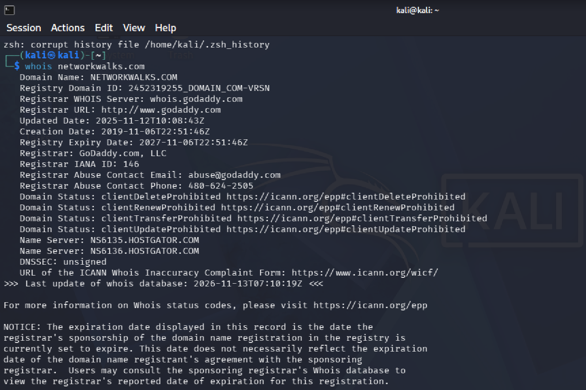
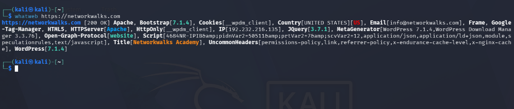
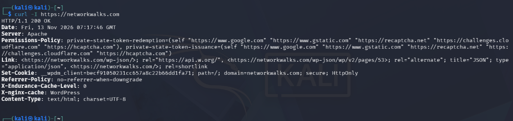
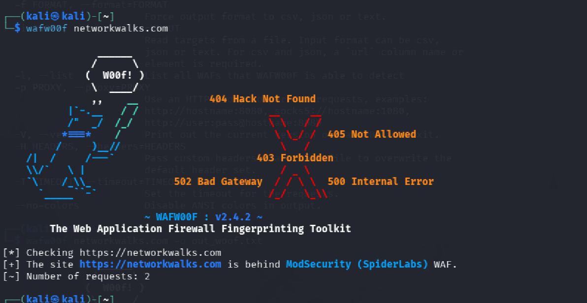
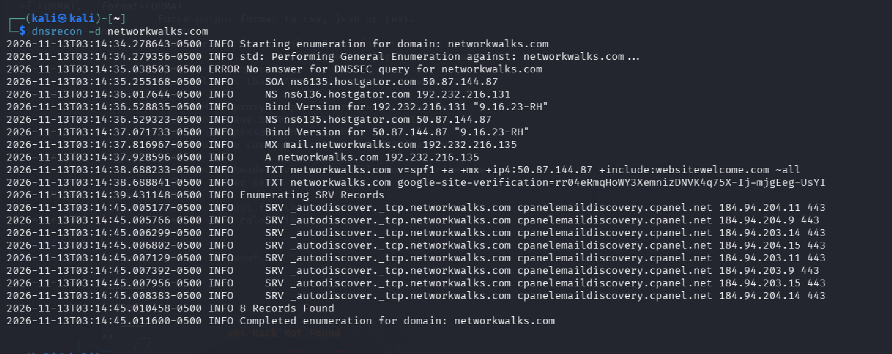
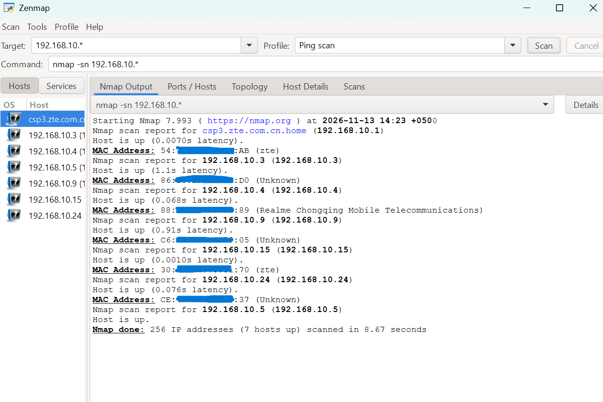
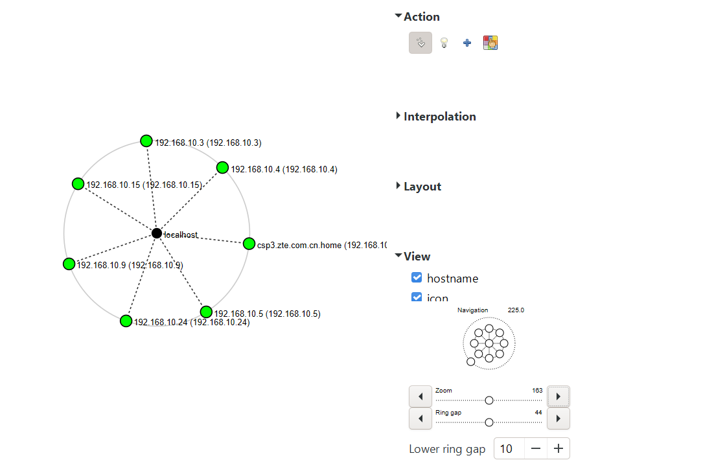

# PENETRATION TESTING REPORT

Footprinting & Network Scanning Phases

W2-PM-FINAL \| Cybersecurity \| Networkwalks

| | |
|---|---|
| **Pentester Name** | Amna Zafar |
| **Program / Batch** | Cybersecurity & Ethical Hacking Internship, Networkwalks |
| **Date** | 13 November 2026 |
| **Modules completed** | W2-PM1 (Multiple Kali Tools) W2-PM5 (Zenmap Scanning) |
| **Client / Target** | 1. networkwalks.com (written permission secured) 2. My own local LAN (192.168.10.0/24) |
| **Permission secured?** | Yes |
| **Phases covered** | Phase 1: Reconnaissance & Footprinting Phase 2: Scanning & Network Discovery Phases 3-5: In progress |

# 1. Liability Disclaimer

I performed these activities only on systems and devices for which I had written permission, or which I own myself. All material in this report is for education and research purposes only. Do not use anything here to break the law. The instructor, the authors and Networkwalks are not responsible for what anyone does with this knowledge. Every action is the individual’s own responsibility. Misuse can lead to criminal charges, heavy fines, loss of employment and a permanent record. In most countries unauthorised access is a crime even when nothing is damaged.

# 2. Introduction

This report covers footprinting of the networkwalks.com domain using several Kali Linux tools (W2-PM1) and discovery of live hosts on my own local network using Zenmap (W2-PM5). One module covers the footprinting phase and the other covers the scanning phase, so together they show how an attacker moves from gathering public information to mapping live hosts on a network. It is the Week 2 deliverable of my internship program at Networkwalks.

The footprinting commands were run in Kali Linux on 13 November 2026, and the network scan was run from a Windows PC with Zenmap (Nmap 7.993) on the same day. For each step the report gives the exact command, the result observed, a screenshot as evidence, and a short note on why the finding matters from an attacker’s point of view.

# 3. Tools Used

| **Tool**             | **Purpose**                                                                         |
|----------------------|-------------------------------------------------------------------------------------|
| Kali Linux & Windows | Operating systems used for the reconnaissance and scanning activities               |
| whois                | Find domain registration details (registrar, dates, name servers)                   |
| whatweb              | Fingerprint web technologies (server, CMS, plugins, IP)                             |
| nslookup             | Resolve the domain name to its IP address using DNS                                 |
| curl -I              | Read the HTTP response headers of the website                                       |
| wafw00f              | Detect whether a Web Application Firewall (WAF) protects the site                   |
| dnsrecon             | Enumerate DNS records (SOA, NS, MX, A, TXT/SPF, SRV)                                |
| Zenmap (Nmap GUI)    | Ping-scan the local subnet to find live hosts, IPs and MAC addresses; draw topology |

# 4. Activities Performed

## 4.1 Footprinting & Reconnaissance (networkwalks.com)

Six tools were used against the target domain. Each one collects a different type of information, and together they build a profile of the target without sending any exploit traffic.

### 4.1.1 WHOIS: domain registration

**Command:**

> whois networkwalks.com

**Result:** The domain was registered on 6 November 2019 through GoDaddy.com, LLC (IANA ID 146). The record was last updated on 12 November 2025 and expires on 6 November 2027. The authoritative name servers are NS6135.HOSTGATOR.COM and NS6136.HOSTGATOR.COM, which shows the site is hosted with HostGator. DNSSEC is reported as unsigned. The domain carries four registrar locks: clientDeleteProhibited, clientRenewProhibited, clientTransferProhibited and clientUpdateProhibited.

**Why it matters:** The registrar, the hosting provider and the key dates are public. An attacker can use the name servers to identify the hosting platform, and the expiry date to judge domain-hijack timing. The registrar locks are a good protection, and no personal registrant data is visible in the output.

*Figure 1: WHOIS output for networkwalks.com*

### 4.1.2 WhatWeb: web technology fingerprinting

**Command:**

> whatweb https://networkwalks.com

**Result:** The site answered HTTP 200 OK. WhatWeb identified Apache as the web server, WordPress 7.1.4 as the CMS, the WP Download Manager plugin version 3.3.76, jQuery 3.7.1, Bootstrap, HTML5 and Google Tag Manager. It also exposed the IP address 192.232.216.135 (country: United States), the contact e-mail info@networkwalks.com, the page title "Networkwalks Academy", the cookie \_\_wpdm_client (HttpOnly) and uncommon headers such as x-endurance-cache-level and x-nginx-cache.

**Why it matters:** CMS and plugin versions are exactly what an attacker looks up in public vulnerability databases. A visible plugin version means the owner must be sure that version is fully patched. The x-endurance-cache-level header also hints at the hosting stack.

*Figure 2: WhatWeb fingerprint of https://networkwalks.com*

### 4.1.3 Nslookup: DNS resolution

**Command:**

> nslookup networkwalks.com

**Result:** Using Google DNS (8.8.8.8) the domain resolved to 192.232.216.135. The answer is marked "Non-authoritative", because it came from a public resolver cache and not from the domain’s own name server.

**Why it matters:** This confirms the public IP address of the web service, which is the starting point for later scanning (only within an authorised scope). It matches the IP found by WhatWeb.

*Figure 3: Nslookup result for networkwalks.com*

### 4.1.4 Curl: HTTP response headers

**Command:**

> curl -I https://networkwalks.com

**Result:** The server returned HTTP/1.1 200 OK with Server: Apache. The Link header exposes the WordPress REST API root (/wp-json/) and a JSON page endpoint (/wp-json/wp/v2/pages/53). Other headers include a Permissions-Policy limiting private-state-token features to Google, reCAPTCHA, Cloudflare and hCaptcha origins, Referrer-Policy: no-referrer-when-downgrade, X-Endurance-Cache-Level: 0 and X-nginx-cache: WordPress. The cookie \_\_wpdm_client is set with the Secure and HttpOnly flags.

**Why it matters:** The REST API links and caching headers help an attacker confirm the CMS and the hosting stack. On the positive side, the cookie flags and the Permissions-Policy are good practice. In this response I did not see HSTS, X-Frame-Options, Content-Security-Policy or X-Content-Type-Options, which would be worth reviewing.

*Figure 4: HTTP response headers from curl -I*

### 4.1.5 Wafw00f: WAF detection

**Command:**

> wafw00f networkwalks.com

**Result:** Wafw00f v2.4.2 reported that https://networkwalks.com is behind the ModSecurity (SpiderLabs) WAF. The detection needed only 2 requests.

**Why it matters:** A WAF is a good defensive layer, and its presence is a positive finding. However, the fact that the WAF vendor can be fingerprinted with two requests tells an attacker which rule set to try to evade.

*Figure 5: Wafw00f detecting ModSecurity (SpiderLabs)*

### 4.1.6 DNSRecon: DNS enumeration

**Command:**

> dnsrecon -d networkwalks.com

**Result:** DNSRecon found 8 records in total plus the SOA, NS, MX, A and TXT data. Key items:

- **SOA / NS:** ns6135.hostgator.com (50.87.144.87) and ns6136.hostgator.com (192.232.216.131).

- **DNS software:** The BIND version of both name servers was disclosed as "9.16.23-RH".

- **MX / A:** mail.networkwalks.com at 192.232.216.135, the same IP as the web server. The A record is also 192.232.216.135.

- **TXT:** SPF record "v=spf1 +a +mx +ip4:50.87.144.87 +include:websitewelcome.com ~all" and a google-site-verification token.

- **SRV:** Eight \_autodiscover.\_tcp SRV records pointing to cpanelemaildiscovery.cpanel.net on port 443.

- **DNSSEC:** The DNSSEC query returned no answer, which agrees with the WHOIS "DNSSEC: unsigned".

**Why it matters:** DNS records give a map of the mail and hosting infrastructure. The SPF record ends in ~all (soft fail), which is weaker against e-mail spoofing than -all. The exposed BIND version lets an attacker check for known issues in that release, and the cPanel SRV records confirm a cPanel-based shared hosting platform.

*Figure 6: DNSRecon enumeration output*

## 4.2 Network Scanning with Zenmap (local LAN)

For the second activity I used Zenmap, the graphical front end of Nmap, on my own home network. The goals were to identify the local subnet, discover live hosts, record their IP and MAC addresses and generate a network topology.

**Target:** 192.168.10.\* (the 192.168.10.0/24 subnet, 256 addresses)

**Profile / command:**

> nmap -sn 192.168.10.\*

**Result:** Nmap 7.993 started on 2026-11-13 at 14:23 (+05:00) and finished with "256 IP addresses (7 hosts up) scanned in 8.67 seconds". The seven live hosts are listed below.

| **IP address** | **MAC address**   | **Vendor** | **Latency** |
|----------------|-------------------|------------|-------------|
| 192.168.10.1   | 54:00:00:00:00:AB | ZTE        | 0.0070 s    |
| 192.168.10.3   | 86:00:00:00:00:D0 | Unknown    | 1.1 s       |
| 192.168.10.4   | 88:00:00:00:00:89 | Realme     | 0.068 s     |
| 192.168.10.5   | Not shown         | \-         | Not shown   |
| 192.168.10.9   | C6:00:00:00:00:05 | Unknown    | 0.91 s      |
| 192.168.10.15  | 30:00:00:00:00:70 | ZTE        | 0.0010 s    |
| 192.168.10.24  | CE:00:00:00:00:37 | Unknown    | 0.076 s     |

**Interpretation:** 192.168.10.1 resolves to a ZTE hostname and is most likely the home router/gateway. 192.168.10.4 belongs to a Realme device, most likely a phone. 192.168.10.5 shows no MAC address, which is normal for the machine running the scan, because Nmap does not print the MAC of the local host. Three hosts (.3, .9 and .24) have MAC addresses whose first byte (86, C6, CE) has the locally-administered bit set; this commonly means a private/randomised MAC as used by modern phones and laptops, so these devices should be identified by name before being trusted.

*Figure 7: Zenmap ping scan (nmap -sn 192.168.10.\*) and Nmap output*

After the scan I opened the Topology tab. Zenmap drew the local machine ("localhost") at the centre with all seven discovered hosts connected around it, which matches the star layout of a typical home Wi-Fi/LAN network with one router.

*Figure 8: Zenmap network topology for 192.168.10.0/24*

# 5. Risk Analysis / Impact

Based on the information collected, I identified the following potential risks. They are observations from information gathering and are not confirmed vulnerabilities.

| **\#** | **Risk / Finding**                  | **Evidence / Observation**                                                                         | **Potential Impact**                                                             | **Level**    |
|--------|-------------------------------------|----------------------------------------------------------------------------------------------------|----------------------------------------------------------------------------------|--------------|
| 1      | CMS and plugin versions exposed     | WhatWeb: WordPress 7.1.4, WP Download Manager 3.3.76                                               | Attackers can look up these exact versions for known weaknesses                  | ● **Medium** |
| 2      | DNS server software version exposed | DNSRecon: BIND "9.16.23-RH" on both name servers                                                   | Helps an attacker research flaws in that BIND release                            | ● **Medium** |
| 3      | Unidentified devices on the LAN     | Zenmap: 7 live hosts, 3 with unknown vendor MAC (.3, .9, .24)                                      | Unknown or unauthorised devices could be present and go unnoticed                | ● **Medium** |
| 4      | Server IP address identifiable      | Nslookup / WhatWeb: 192.232.216.135 (web and mail on the same IP)                                  | Reveals the network location of the web and mail service                         | ● **Low**    |
| 5      | HTTP technical information exposed  | curl -I: /wp-json/ links, X-Endurance-Cache-Level, X-nginx-cache; no HSTS/CSP/X-Frame-Options seen | Assists fingerprinting; missing hardening headers reduce browser-side protection | ● **Low**    |
| 6      | WAF technology identifiable         | Wafw00f: ModSecurity (SpiderLabs) found in 2 requests                                              | Tells an attacker which WAF rules to try to bypass                               | ● **Low**    |
| 7      | Weak e-mail / DNS trust settings    | SPF ends with ~all (soft fail); DNSSEC unsigned                                                    | Makes spoofing and DNS tampering somewhat easier                                 | ● **Low**    |
| 8      | Public registration data            | WHOIS: registrar, dates, HostGator name servers; registrar locks on                                | Gives hosting context; the locks reduce hijack risk                              | ● **Info**   |

**Risk level key:** ● Medium ● Low ● Info

The practical exercises involved only information gathering and host discovery. No exploitation or vulnerability validation was performed. The presence of a software version, an IP address or a DNS record does not by itself mean that a system is vulnerable; further authorised testing would be required to confirm any actual vulnerability.

### Positive observations

- A WAF (ModSecurity) is active in front of the website.

- The site is served over HTTPS and the session cookie uses the Secure and HttpOnly flags.

- The domain has all four registrar locks enabled and shows no personal registrant data.

- A Permissions-Policy header and an SPF record are already in place.

# 6. Recommendations

- **Reduce version disclosure.** Hide or minimise the WordPress version and plugin version information shown in page source, meta tags and headers, and review what the REST API (/wp-json/) exposes to anonymous visitors.

- **Keep software updated.** Update WordPress core, WP Download Manager and all other plugins regularly and check them against current security advisories.

- **Add security headers.** Review adding Strict-Transport-Security, X-Frame-Options (or CSP frame-ancestors), X-Content-Type-Options and a Content-Security-Policy.

- **Harden DNS.** Ask the hosting provider to hide the BIND version, consider enabling DNSSEC, and review SPF: moving from ~all to -all once all sending sources are confirmed.

- **Keep the WAF enabled and tuned.** ModSecurity is already blocking basic attacks; keep its rule set updated and monitor its logs.

- **Scan your own network regularly.** Periodically run host discovery on the LAN and compare the result with a list of known devices.

- **Investigate unknown devices.** Identify the devices at 192.168.10.3, .9 and .24 (for example through the router’s client list) and remove anything not recognised. Change the Wi-Fi password if needed.

- **Maintain network documentation.** Keep an up-to-date inventory and topology diagram of devices, IPs and MAC addresses.

- **Test only with authorisation.** Reconnaissance and scanning must be performed only on systems where written permission exists.

# 7. Conclusion

In Week 2 of my Cybersecurity & Ethical Hacking internship I completed practical work covering footprinting, reconnaissance and network scanning. In the footprinting activity, six Kali Linux tools showed how much can be learned about networkwalks.com from public sources alone: WHOIS gave the registrar and hosting details, WhatWeb revealed WordPress 7.1.4 and the WP Download Manager plugin, Nslookup gave the IP 192.232.216.135, Curl exposed the REST API and caching headers, Wafw00f identified ModSecurity, and DNSRecon mapped name servers, mail and SPF records.

In the scanning activity, Zenmap showed seven live hosts on my 192.168.10.0/24 network, with their IP and MAC addresses, and drew a topology that centres on the local machine. Three of the devices had unknown vendors, which is a reminder to keep an inventory of what is connected to a network.

The exercises showed me that information gathering is a key part of cybersecurity: even before any exploitation, a lot can be learned from public information and network responses. A good report should explain what was done, what was found, what it means, what risk it creates and how to reduce that risk. Finally, all reconnaissance and scanning must stay within an authorised scope, and these activities were completed as part of an assigned educational lab.

# 8. Evidences Collected

| **Figure** | **Screenshot file** | **Evidence of**                          |
|------------|---------------------|------------------------------------------|
| 1          | 1_whois.png         | whois networkwalks.com                   |
| 2          | 2_what_1.png        | whatweb https://networkwalks.com         |
| 3          | 3_nslookup.png      | nslookup networkwalks.com                |
| 4          | 4_curl.png          | curl -I https://networkwalks.com         |
| 5          | 5_waf.png           | wafw00f networkwalks.com                 |
| 6          | 6_dns.png           | dnsrecon -d networkwalks.com             |
| 7          | 7_zenmap.png        | Zenmap ping scan: nmap -sn 192.168.10.\* |
| 8          | 8_zenmap2.png       | Zenmap topology view                     |
